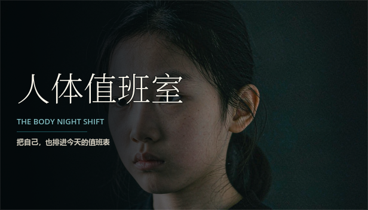
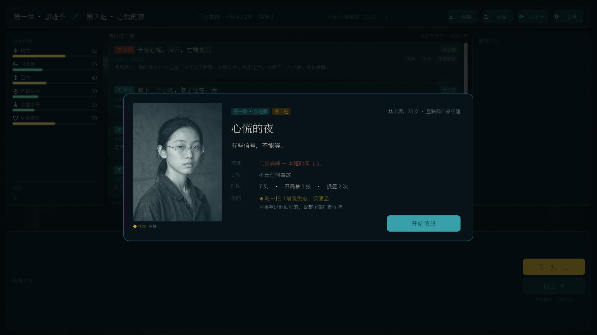
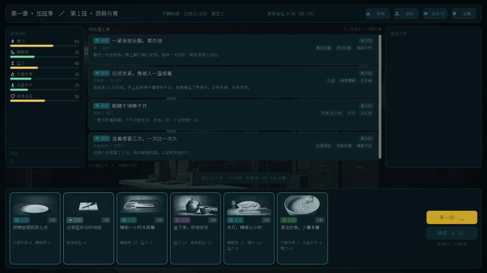
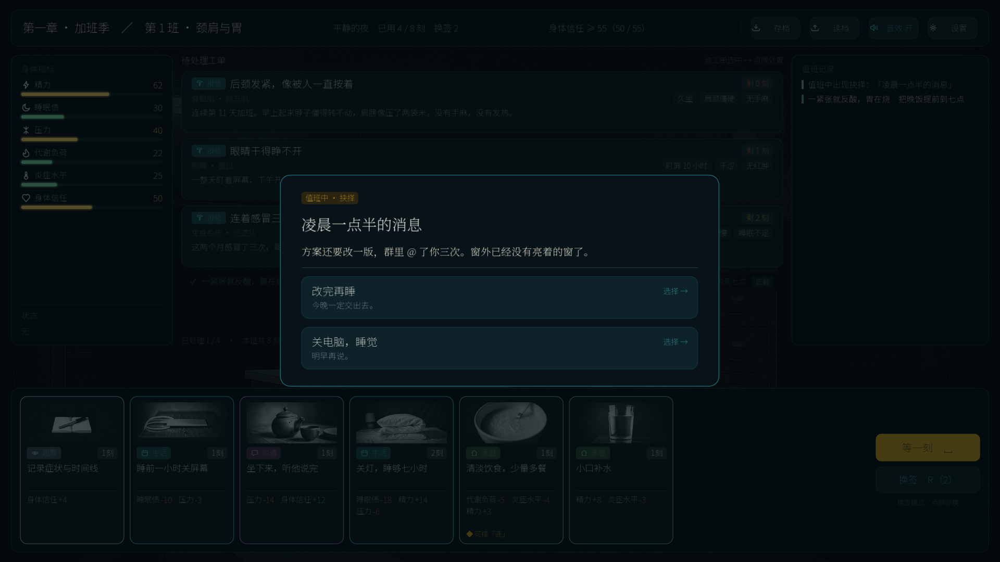
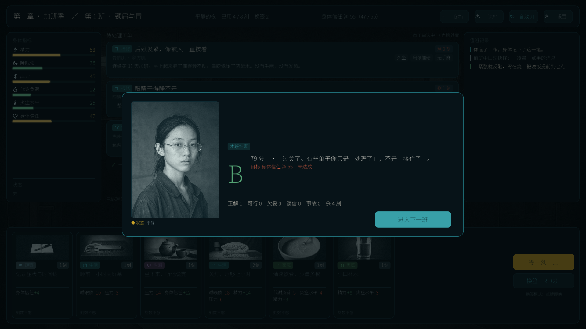

# 人体值班室 · Room of the Body

> 你是这具身体的夜班值班员。二十五班，六十五张工单，四十三张处置签。
> 信息不全、时间不够、家属在催——你能做的，只是别把他推下悬崖。

一个关于**健康信息如何被误解**的卡牌叙事游戏。你扮演一位住进亲属身体里的值班员，
在五个章节里经历加班季、体检报告、减重、陪诊、独居衰老——每张工单都是一次
真实世界常见的困惑，每次出牌都要在「立刻舒服」和「长期正确」之间选一个。

[](LICENSE)
[](LICENSE-CONTENT)
[](https://godotengine.org)
[](https://github.com/qbclex/renti-banzhishi/releases/latest)



## 玩法

| | |
|---|---|
| **5 章 25 班** | 加班季 / 体检报告 / 瘦下去 / 两个人的值班 / 一个人的夜班 |
| **65 张工单** | 每张是一次真实场景：颈肩疼、体检报告上的箭头、漏服、老人不肯去医院 |
| **43 张处置签** | 你的手牌。观察、解释、转诊、陪伴，以及「先缓解一下」的捷径 |
| **6 项指标** | 精力 / 睡眠 / 压力 / 代谢 / 炎症 / 信任，牵一发动全身 |
| **班末评级** | S/A/B/C 取决于你当班造成的事故数、误导次数与信任变化 |

三件事让这游戏不那么「好过」：

- **时间不够。** 每班有时限刻数，先做哪个判断就是全部难度所在。
- **捷径真的有用。** 止痛药、果汁排毒、碱性水——它们当班就见效，长期把指标带偏。
- **宿主会自己作。** 某些班次开场，他会带着一张自己买的偏方回来，你甩不掉，只能用完。

| 班次简报 | 值班出牌 |
|---|---|
|  |  |

| 两难抉择 | 班末结算 |
|---|---|
|  |  |

## 怎么跑

### 方式一：直接用发布包（Windows）

```bat
build_win.bat
```

产出 `godot_poc/build/windows/RenTiBanZhiShi.exe`（单文件，约 120 MB，PCK 已内嵌）。
需要本机装有 Godot 4.7.2 的**导出模板**（编辑器 → 管理导出模板 → 下载）。

> 双击 exe 时 Windows 可能弹「已保护你的电脑」——这是「无代码签名」的默认提示，
> 不是杀毒报告。点「更多信息 → 仍要运行」即可。

### 方式二：从源码跑（开发时用）

```bat
launch_godot.bat
```

它会按 `%GODOT_BIN%` → PATH → 默认安装目录 的顺序找 Godot，**不写死任何人的本机路径**。
clone 下来第一次运行时，它会自动先做一次资源导入（生成 `.godot/` 缓存，约一分钟）——
没有这步缓存，所有贴图和字体都会加载失败。

Linux / macOS：

```bash
godot --headless --path godot_poc --import   # 只需一次
godot --path godot_poc
```

### 方式三：不装引擎，只跑规则

规则层是纯 Python，没有第三方依赖：

```bash
python -c "import engine; g,st = engine.simulate(seed=13); print(st['campaign']['ratings'])"
```

## 项目结构

```
.
├── engine.py              参考实现：全部规则、随机、结算（纯 Python，无依赖）
├── content_full.py         内容单源：章节 / 班次 / 工单 / 处置签 / 抉择 / 奖励
├── gen_data_gd.py          内容 → godot_poc/data.gd，带交叉引用与可达性自检
├── game.py / audio.py / poc_data.py   早期 tkinter 原型，已废弃，仅作留档
├── tools/parity_check.py   双引擎逐行比对
├── launch_godot.bat        从源码启动
├── build_win.bat           导出 + 自检 + 巡演，三道闸门跑完才算构建成功
├── docs/screenshots/
└── godot_poc/              Godot 4.7.2 工程
    ├── engine.gd           与 engine.py 逐位一致的移植
    ├── data.gd             生成物，不要手改
    ├── ui/                 界面层：只负责画和收输入，不含规则
    ├── audio/              程序化合成 BGM 与音效，不含音频文件
    ├── assets/             chars / bg / cards / icons（处理后可直接用）
    ├── fonts/              思源黑体 + 宋体子集（各约 1 MB）
    ├── tests/              45 例
    └── tools/              立绘、背景、商店图、字体子集的生成脚本
```

### 数据流

内容是**单源**的，改一处只改一个文件：

```
content_full.py  ──gen_data_gd.py──▶  godot_poc/data.gd  ──▶  Godot 运行时
       │
       └──────────────────────────▶  engine.py（Python 参考实现）
```

`gen_data_gd.py` 不是简单搬运，它同时做**校验**：引用了不存在的工单、牌、抉择，
某张牌既不在初始牌组也不在任何奖励里（永远拿不到的死数据），任何一项不通过就拒绝生成。

改完内容必须重新生成，否则 Godot 那边还是旧数据：

```bash
python gen_data_gd.py
```

## 测试

```bash
cd godot_poc && python -m unittest discover -s tests    # 45 例，约 40 秒
cd .. && python tools/parity_check.py                   # 双引擎 8 种子逐行比对
```

刚 clone 下来、还没跑过游戏时，先执行一次资源导入，否则依赖引擎的用例会因为没有
`.godot/` 缓存而失败（有 Godot 时）：

```bash
godot --headless --path godot_poc --import
```

找不到 Godot 时，依赖引擎的用例自动 skip，静态断言照常跑——所以这个仓库在
没有装 Godot 的机器上也能验一半。

运行时还有几个开关，用来在没有人工点击的情况下证明游戏是好的：

| 开关 | 作用 |
|---|---|
| `-- --autoplay` | 无头跑完 25 班，打印评级与是否通关 |
| `-- --chaos` | 随机乱点，验证界面不会卡在无出口状态 |
| `-- --selfcheck` | 检查立绘/背景/图标/卡面/字体/存档，缺任何一项即失败 |
| `-- --packlist` | 列出包内真实资源，核对导出是否漏文件 |
| `-- --audiocheck` | 确认 BGM 真的在播（需要窗口） |
| `-- --shot` | 批量出 1920×1080 截图到 `_shots/` |

`build_win.bat` 会把 `--selfcheck` 与 `--autoplay` 串成发布闸门：**自检不过就不产出 exe**。
这条规则是被一个 bug 逼出来的——导入管线会把 `.png/.webp/.svg/.ttf` 变成 `.ctex`，
运行时代码按原路径读图就会静默降级成空白，而巡演依然全绿。现在自检直接数资源个数，
空一个就判失败。

## 为什么有两份引擎

`engine.py` 和 `engine.gd` 是同一套规则的两次实现。听起来是自找麻烦，但这是这个项目
唯一可行的做法：先在 Python 里把数值调到手感合适（改一行、跑 60 局、看分布），
再翻译成 GDScript 进引擎。

代价是两份实现会悄悄分叉——所以有了 `tools/parity_check.py`：同一批种子下，
两端的每一次出牌、抉择、结算和六项指标必须**逐行相同**，diff 非空就是失败。
它抓过的真 bug 包括：GDScript 的整数除法、数组 shuffle 的随机源、以及
「班末先结算还是先弹抉择」这种只有时间顺序错位才暴露的差异。

## 授权

**代码**（`*.py` `*.gd` `*.tscn` `*.bat` 及构建脚本）— [MIT](LICENSE)

**内容**（剧情、文案、工单、美术、设定）— [CC BY-NC-SA 4.0](LICENSE-CONTENT)

- ✅ 随便读、随便改、做视频、写文章、拿去上课
- ✅ 基于它改出自己的版本（需署名，且同样以 CC BY-NC-SA 发布）
- ❌ 不能拿去卖钱，或放在付费墙后面

第三方组件（Godot 引擎 MIT、思源字体 OFL）见 [NOTICE](NOTICE)。

## 素材与 AI 披露

角色立绘、卡面插画、背景图由**生成式图像模型**产出，再经人工筛选、裁切、调色和统一风格。
全部写作、玩法设计、代码、测试，以及运行时程序化合成的音乐与音效，均为人工创作。

需要说明的是：纯 AI 输出在部分司法辖区不受著作权保护，所以本项目对这部分素材的
CC BY-NC-SA 声明，只覆盖作者可主张权利的部分——即编排、裁切、调色这些人工加工。
换句话说：**你可以自由使用，但别指望靠它主张独占**。

仓库不含 AI 生成的原始大图（`art_src/`、`chars_src/`、`bg_src/`，共约 150 MB，
且带工具水印）。游戏实际使用的是处理后的 `chars/` `bg/` `cards/` `icons/`，
克隆下来即可运行。

## 医疗免责

这是一个**关于沟通与误解**的游戏，不是医疗工具。游戏里的症状描述、处置建议与
就医判断，是为了让玩家体会「信息不全时人如何犯错」，**不构成任何医疗建议**。
真实健康问题请咨询执业医师。若你或身边的人正在经历进食障碍、孕期焦虑、
独居老人的照护困境，请寻求专业帮助。

## 已知限制

- 只有简体中文。文本量约 1.9 万字（另有大量短文案），翻译是独立工程。
- 仅键鼠操作，无手柄支持，Steam Deck 上体验不佳。
- Windows 为主要目标平台；Linux/macOS 理论可跑（Godot 跨平台），但导出配置只写了 Windows。
- 存档只有一个槽位。

---

如果这个项目对你有用，欢迎开 issue 说说你玩到哪一班卡住了——尤其是
**哪张工单的措辞让你觉得不对**，这类反馈比 bug 报告更有价值。
